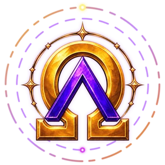

  

<h1 align="center">Project Nox · Identidade Institucional</h1>

  Recursos oficiais de identidade visual, documentação e diretrizes da organização <strong>Project Nox</strong>.

## Sobre este repositório

O repositório **`.github`** centraliza os arquivos institucionais e comunitários compartilhados pela organização **Project Nox** no GitHub. Seu papel é oferecer suporte estrutural e visual aos projetos do ecossistema, reunindo em um só lugar a apresentação da organização, os ativos oficiais de marca e as orientações de colaboração.

Este espaço funciona exclusivamente como repositório institucional de apoio: ele **não** abriga a aplicação web de mangás, o repositório das extensões nem a Central Oficial publicada no GitHub Pages.

O nome **`.github`** possui uma finalidade especial na plataforma e deve ser preservado: ele permite que o GitHub exiba [`profile/README.md`](profile/README.md) na página inicial da organização e utilize definições comunitárias padrão (como [`CONTRIBUTING.md`](CONTRIBUTING.md)) nos repositórios que não possuem versões próprias. Em contrapartida, os recursos visuais armazenados aqui não são aplicados automaticamente aos demais projetos — quando utilizados em outros repositórios ou páginas, precisam ser referenciados explicitamente.

## O que você encontra aqui?

- **Perfil da organização ([`profile/README.md`](profile/README.md)):** apresentação pública exibida na página principal do Project Nox no GitHub.
- **Identidade visual ([`assets/`](assets/)):** banners institucionais (`nox-hero-*`, `nox-banner.png`) e faixas de princípios (`nox-philosophy-*`) com variantes para desktop, mobile, tema claro e tema escuro.
- **Elementos de marca ([`assets/brand/`](assets/brand/)):** emblema oficial (`nox-emblem.webp`), avatar institucional (`nox-avatar.png`), marcas vetoriais (`nox-mark-*`) e notas de referência ([`assets/brand/README.md`](assets/brand/README.md)) para preservar consistência entre projetos.
- **Diretrizes de contribuição ([`CONTRIBUTING.md`](CONTRIBUTING.md)):** orientações gerais para abrir solicitações, relatar problemas e colaborar com o ecossistema.
- **Licenciamento ([`LICENSE`](LICENSE)):** texto integral da licença GNU Affero General Public License v3.0 aplicável a este repositório.
- **Ferramentas auxiliares ([`scripts/`](scripts/)):** utilitário em Python (`sync-emblem.py`) e dependências (`requirements.txt`) usados para sincronizar e gerar os ativos derivados de marca em `assets/` e `assets/brand/`.

## Identidade e consistência

Os recursos deste repositório ajudam a preservar unidade visual, reconhecimento institucional e clareza documental nos projetos da organização. Eles funcionam como referência compartilhada do Project Nox, sem impor novas regras obrigatórias de marca nem pressupor que materiais visuais ou conteúdos de outros projetos compartilhem automaticamente as mesmas condições de licenciamento.

## Ecossistema Project Nox

- [**Organização no GitHub**](https://github.com/ProjectNox-org) — Página inicial pública com a apresentação da iniciativa e acesso aos repositórios abertos.
- [**Central Oficial do Project Nox**](https://projectnox-org.github.io/) — Portal oficial indicado para descobrir todos os projetos ativos, consultar documentações e acompanhar novidades.

## Contribuição e licenciamento

Para colaborar com o ecossistema, consulte [`CONTRIBUTING.md`](CONTRIBUTING.md) e siga as orientações específicas do repositório envolvido.

Este repositório é disponibilizado sob a **GNU Affero General Public License v3.0** — consulte [`LICENSE`](LICENSE) para os termos completos.

  <strong>Project Nox</strong> · Fundado por <a href="https://github.com/Awerkori">Awerkori</a>

