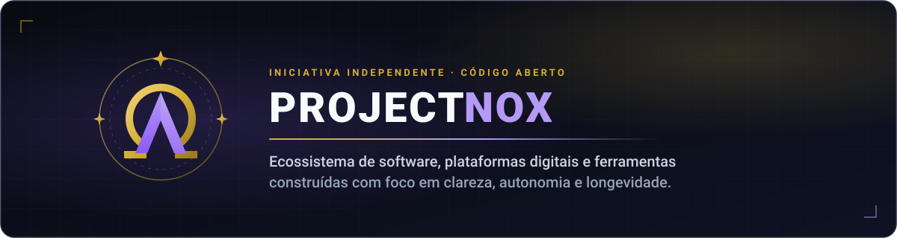

  <picture>
    <source media="(prefers-color-scheme: dark) and (max-width: 767px)" srcset="https://raw.githubusercontent.com/ProjectNox-org/.github/main/assets/nox-hero-mobile-dark.svg">
    <source media="(prefers-color-scheme: light) and (max-width: 767px)" srcset="https://raw.githubusercontent.com/ProjectNox-org/.github/main/assets/nox-hero-mobile-light.svg">
    <source media="(prefers-color-scheme: dark)" srcset="https://raw.githubusercontent.com/ProjectNox-org/.github/main/assets/nox-hero-dark.svg">
    <source media="(prefers-color-scheme: light)" srcset="https://raw.githubusercontent.com/ProjectNox-org/.github/main/assets/nox-hero-light.svg">
    
  </picture>

## Sobre o Project Nox

O **Project Nox** é uma iniciativa independente de tecnologia e desenvolvimento de software, dedicada à criação de projetos autorais, ferramentas e soluções digitais em código aberto.

Sua trajetória começou com extensões e utilitários voltados aos ecossistemas de mangás e animes. Com o tempo, esse trabalho evoluiu naturalmente para plataformas web, sistemas próprios, automações, ferramentas de desenvolvimento e iniciativas envolvendo **agentes de inteligência artificial**.

Mais do que atuar em uma área específica, o ecossistema permanece aberto a novas ideias, desafios e possibilidades. Seu desenvolvimento é guiado pela experimentação, pela utilidade prática e pela evolução contínua junto à comunidade — incorporando novos projetos sem precisar redefinir sua identidade a cada expansão.

 

  <picture>
    <source media="(prefers-color-scheme: dark) and (max-width: 767px)" srcset="https://raw.githubusercontent.com/ProjectNox-org/.github/main/assets/nox-philosophy-mobile-dark.svg">
    <source media="(prefers-color-scheme: light) and (max-width: 767px)" srcset="https://raw.githubusercontent.com/ProjectNox-org/.github/main/assets/nox-philosophy-mobile-light.svg">
    <source media="(prefers-color-scheme: dark)" srcset="https://raw.githubusercontent.com/ProjectNox-org/.github/main/assets/nox-philosophy-dark.svg">
    <source media="(prefers-color-scheme: light)" srcset="https://raw.githubusercontent.com/ProjectNox-org/.github/main/assets/nox-philosophy-light.svg">
    
  </picture>

 

Para descobrir os projetos, consultar documentações e acompanhar os recursos do ecossistema, acesse a [**Central Oficial do Project Nox**](https://projectnox-org.github.io/).

---

  <strong>Project Nox</strong> · Fundado por <a href="https://github.com/Awerkori">Awerkori</a>

