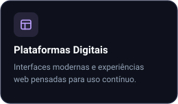
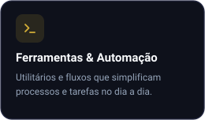
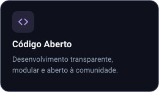
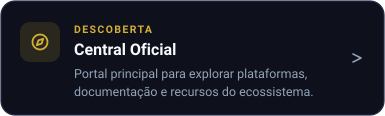
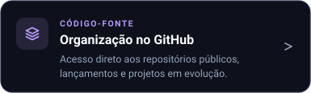
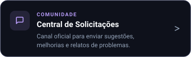
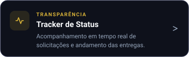

  <picture>
    <source media="(prefers-color-scheme: dark)" srcset="https://raw.githubusercontent.com/ProjectNox-org/.github/main/assets/nox-hero-dark.svg">
    <source media="(prefers-color-scheme: light)" srcset="https://raw.githubusercontent.com/ProjectNox-org/.github/main/assets/nox-hero-light.svg">
    
  </picture>

  <a href="https://projectnox-org.github.io/">
    <picture>
      <source media="(prefers-color-scheme: dark)" srcset="https://raw.githubusercontent.com/ProjectNox-org/.github/main/assets/btn-central-dark.svg">
      <source media="(prefers-color-scheme: light)" srcset="https://raw.githubusercontent.com/ProjectNox-org/.github/main/assets/btn-central-light.svg">
      
    </picture>
  </a>
  &nbsp;
  <a href="https://github.com/ProjectNox-org">
    <picture>
      <source media="(prefers-color-scheme: dark)" srcset="https://raw.githubusercontent.com/ProjectNox-org/.github/main/assets/btn-org-dark.svg">
      <source media="(prefers-color-scheme: light)" srcset="https://raw.githubusercontent.com/ProjectNox-org/.github/main/assets/btn-org-light.svg">
      
    </picture>
  </a>
  &nbsp;
  <a href="https://github.com/ProjectNox-org/project-nox-requests">
    <picture>
      <source media="(prefers-color-scheme: dark)" srcset="https://raw.githubusercontent.com/ProjectNox-org/.github/main/assets/btn-requests-dark.svg">
      <source media="(prefers-color-scheme: light)" srcset="https://raw.githubusercontent.com/ProjectNox-org/.github/main/assets/btn-requests-light.svg">
      
    </picture>
  </a>

  <picture>
    <source media="(prefers-color-scheme: dark)" srcset="https://raw.githubusercontent.com/ProjectNox-org/.github/main/assets/nox-divider-dark.svg">
    <source media="(prefers-color-scheme: light)" srcset="https://raw.githubusercontent.com/ProjectNox-org/.github/main/assets/nox-divider-light.svg">
    
  </picture>

## Sobre o Project Nox

O **Project Nox** é uma iniciativa independente de tecnologia e código aberto dedicada à criação de software, plataformas digitais, ferramentas e automações. Desenvolvemos soluções pensadas para uso real, com foco em clareza, autonomia e evolução contínua junto à comunidade.

  <picture>
    <source media="(prefers-color-scheme: dark)" srcset="https://raw.githubusercontent.com/ProjectNox-org/.github/main/assets/pillar-platforms-dark.svg">
    <source media="(prefers-color-scheme: light)" srcset="https://raw.githubusercontent.com/ProjectNox-org/.github/main/assets/pillar-platforms-light.svg">
    
  </picture>
  &nbsp;
  <picture>
    <source media="(prefers-color-scheme: dark)" srcset="https://raw.githubusercontent.com/ProjectNox-org/.github/main/assets/pillar-tools-dark.svg">
    <source media="(prefers-color-scheme: light)" srcset="https://raw.githubusercontent.com/ProjectNox-org/.github/main/assets/pillar-tools-light.svg">
    
  </picture>
  &nbsp;
  <picture>
    <source media="(prefers-color-scheme: dark)" srcset="https://raw.githubusercontent.com/ProjectNox-org/.github/main/assets/pillar-opensource-dark.svg">
    <source media="(prefers-color-scheme: light)" srcset="https://raw.githubusercontent.com/ProjectNox-org/.github/main/assets/pillar-opensource-light.svg">
    
  </picture>

  <picture>
    <source media="(prefers-color-scheme: dark)" srcset="https://raw.githubusercontent.com/ProjectNox-org/.github/main/assets/nox-divider-dark.svg">
    <source media="(prefers-color-scheme: light)" srcset="https://raw.githubusercontent.com/ProjectNox-org/.github/main/assets/nox-divider-light.svg">
    
  </picture>

## Explorar e Participar

A descoberta completa dos projetos, documentações e canais de acompanhamento acontece diretamente nos portais oficiais do ecossistema:

  <a href="https://projectnox-org.github.io/">
    <picture>
      <source media="(prefers-color-scheme: dark)" srcset="https://raw.githubusercontent.com/ProjectNox-org/.github/main/assets/card-central-dark.svg">
      <source media="(prefers-color-scheme: light)" srcset="https://raw.githubusercontent.com/ProjectNox-org/.github/main/assets/card-central-light.svg">
      
    </picture>
  </a>
  &nbsp;
  <a href="https://github.com/ProjectNox-org">
    <picture>
      <source media="(prefers-color-scheme: dark)" srcset="https://raw.githubusercontent.com/ProjectNox-org/.github/main/assets/card-github-dark.svg">
      <source media="(prefers-color-scheme: light)" srcset="https://raw.githubusercontent.com/ProjectNox-org/.github/main/assets/card-github-light.svg">
      
    </picture>
  </a>
   
  <a href="https://github.com/ProjectNox-org/project-nox-requests">
    <picture>
      <source media="(prefers-color-scheme: dark)" srcset="https://raw.githubusercontent.com/ProjectNox-org/.github/main/assets/card-requests-dark.svg">
      <source media="(prefers-color-scheme: light)" srcset="https://raw.githubusercontent.com/ProjectNox-org/.github/main/assets/card-requests-light.svg">
      
    </picture>
  </a>
  &nbsp;
  <a href="https://projectnox-org.github.io/project-nox-tracker/">
    <picture>
      <source media="(prefers-color-scheme: dark)" srcset="https://raw.githubusercontent.com/ProjectNox-org/.github/main/assets/card-tracker-dark.svg">
      <source media="(prefers-color-scheme: light)" srcset="https://raw.githubusercontent.com/ProjectNox-org/.github/main/assets/card-tracker-light.svg">
      
    </picture>
  </a>

  <picture>
    <source media="(prefers-color-scheme: dark)" srcset="https://raw.githubusercontent.com/ProjectNox-org/.github/main/assets/nox-divider-dark.svg">
    <source media="(prefers-color-scheme: light)" srcset="https://raw.githubusercontent.com/ProjectNox-org/.github/main/assets/nox-divider-light.svg">
    
  </picture>

  <strong>Project Nox</strong> &nbsp;·&nbsp; Fundado por <a href="https://github.com/Awerkori"><strong>Awerkori</strong></a> 
  Iniciativa independente de software, tecnologia e código aberto.

