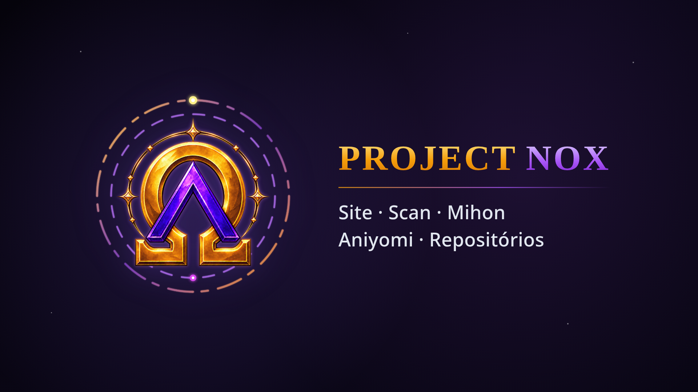

  

<h1 align="center">Project Nox</h1>

  Um ecossistema de mangás, animes e ferramentas para a comunidade.

  <a href="https://github.com/ProjectNox-org/project-nox-manga"><strong>Plataforma de mangá</strong></a>
  &nbsp;·&nbsp;
  <a href="https://github.com/ProjectNox-org/project-nox-requests"><strong>Central de solicitações</strong></a>
  &nbsp;·&nbsp;
  <a href="https://projectnox-org.github.io/project-nox-tracker/"><strong>Acompanhar extensões</strong></a>

---

## Nosso ecossistema

O Project Nox reúne uma plataforma de leitura, extensões para aplicativos de mangá e anime, automações de catálogo e ferramentas para organizar as solicitações da comunidade.

### Mangá

- [**Plataforma Project Nox Manga**](https://github.com/ProjectNox-org/project-nox-manga) — plataforma web e leitor de mangás.
- [**Extensões para Mihon e forks**](https://github.com/ProjectNox-org/manga-extensoes) — catálogo oficial e distribuição (`index.pb`).
- [**Código-fonte das extensões**](https://github.com/ProjectNox-org/manga-fonte-extensoes) — fontes em Kotlin e pipeline de compilação.
- [**Importer de Catálogo**](https://github.com/ProjectNox-org/project-nox-importer) — serviço autônomo de ingestão, validação e storage.

### Anime

- [**Extensões para Aniyomi e forks**](https://github.com/ProjectNox-org/anime-extensoes) — catálogo oficial e distribuição (`index.pb`).
- [**Código-fonte das extensões**](https://github.com/ProjectNox-org/anime-fonte-extensoes) — fontes em Kotlin, extractors e pipeline de compilação.

### Comunidade e ferramentas

- [**Central de solicitações**](https://github.com/ProjectNox-org/project-nox-requests) — pedidos de extensões e relatos de problemas.
- [**Tracker**](https://projectnox-org.github.io/project-nox-tracker/) ([repositório](https://github.com/ProjectNox-org/project-nox-tracker)) — acompanhamento em tempo real de status e pedidos.
- [**Central Staff**](https://github.com/ProjectNox-org/project-nox-scan-staff) — painel editorial e fluxo de trabalho da equipe de scan.
- [**Nox Extension Developer**](https://github.com/ProjectNox-org/nox-extension-developer) — skill para desenvolvimento de extensões de mangá, anime e novel.

## Como contribuir

Encontrou um problema ou tem uma sugestão? Consulte a [Central de solicitações](https://github.com/ProjectNox-org/project-nox-requests) e as orientações de cada repositório antes de abrir uma issue ou enviar uma contribuição.

---

  Fundado por <a href="https://github.com/Awerkori"><strong>Awerkori</strong></a> 
  Fundador e proprietário oficial do Project Nox

